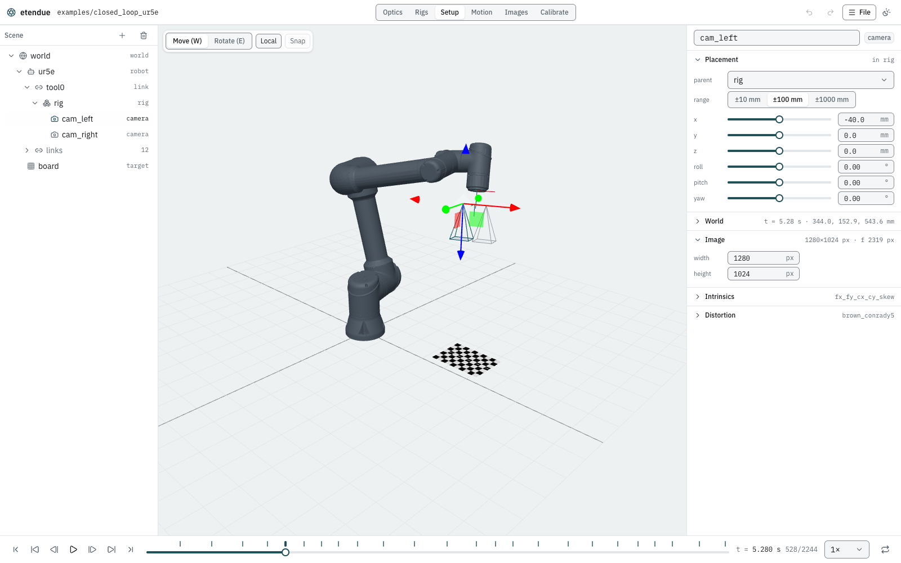

# The studio

etendue studio is the desktop app. It designs heads and rigs from your component library, builds
and plays a cell in 3-D, programs and jogs the robot, shows what every camera sees, and
generates and calibrates datasets.

To install it, see [Installation](installation.md#the-desktop-app). A build from source also runs
in a browser, with [some limits](#in-a-browser).

## The window

- **The header** shows the open cell (a ● after its name marks unsaved changes), the
  **workspace** switch, **Undo** and **Redo** (⌘Z and ⇧⌘Z; Ctrl+Z and Ctrl+⇧Z on Windows and
  Linux), the **File** menu and the light/dark theme.
- **The workspaces** are Optics, Rigs, Setup, Motion, Images and Calibrate. Each has its own
  panels around a main view.
- **The playback bar** along the bottom plays, pauses, scrubs and loops the scenario at a chosen
  speed. Captures are marked on the timeline.

Every edit is applied at once, and the views follow. An edit that would make the scene invalid
(an item attached to nothing, a start pose outside the joint limits) is refused with the reason,
and nothing changes.

## The File menu

Everything that opens, saves or exports is in the **File** menu.

| Item | What it does |
|---|---|
| **Open project…** | Open a project folder (one with `etendue-project.json`): its cells and its library. See [Projects and the library](library.md). |
| **New project…** | Make a project in an empty folder, with a copy of the examples' library and its defaults, and no cells yet. |
| **Reopen _name_** | (Browser) Open the project of an earlier session again, once the browser allows it. |
| **Open scene…** | Pick a scene file, and optionally its scenario in the same dialog. Robots are found by the scene's paths, else in the app's robot library. |
| **Open files…** | (Browser) Choose a scene, an optional scenario and the robot files it needs. Dropping files on the window does the same. |
| **Import tool poses…** | Replace the scenario with a stop-and-shoot one built from a file of tool poses, as [`etendue scenario from-poses`](cli.md#scenario-from-poses) does. |
| **Save**, **Save as…** | Write the scene, and its scenario as `scenario.json` next to it. Robot paths are rewritten relative to where it is saved. A built-in example is never overwritten: saving it asks where. In a browser, **Download scene** downloads both files. |
| **Save as a cell of _project_…** | Add the scene and scenario to the open project as a new cell folder, listed in its manifest. |
| **Export** | The capture poses of a robot (CSV or JSON), its joint trajectory (CSV), the motion report (JSON), the scenario, or the baked motion. The formats are those of [`etendue export`](cli.md#export). |
| The cells | The open project's cells (at start, the built-in examples). Choose one to open it. |

A scene that does not validate leaves the previous one open and lists its problems.

## Optics

Design a laser-triangulation head — a camera and a line laser fixed to its body — against the
window it must measure in. The workspace works on the project's library, not on the open cell.
The physics is in [Triangulation heads](models/heads.md), and the
[head design tutorial](tutorials/head_design.md) walks through it.

**Design** (left):
- **Parts**: a sensor, a lens and a laser from the library, or a saved head.
- **Camera**: f-number, focus distance and sensor tilt.
- **Laser**: its baseline off the camera axis, its height, the point on the axis it aims at, and
  where it is focused. A laser the library does not give a fixed focus is focusable;
  **Focus at the aim** focuses it at the aim point again.
- **Window**: its depth along the laser, its width along the line, and the largest blur allowed.
- **Scheimpflug** tilts the sensor and refocuses so the plane of best focus is the laser plane.
- **Optimise** searches the tilt (or keeps the sensor square), the focus and the f-number for the
  smallest worst blur over the window, starting from the current design. **Apply** takes the
  result; **Discard** drops it.
- **Search _n_ lenses** optimises the head with every lens in the library and ranks them: the
  most of the window seen first, then the smallest worst blur. Each row also shows the coarsest
  depth per pixel, since a shorter lens blurs less but resolves depth more coarsely. **Apply**
  takes that lens and its setting.
- **Save to library** writes the head to `library/heads/<id>.json`. **Place in cell** adds its
  camera and laser to the open cell, under the selected frame.

**Section** (centre, top): the plane through the camera axis across the laser plane, to scale:
the sensor, the principal planes H and H′, the pupils, the field, rays from the window's near,
middle and far points, the laser and its window, the plane of best focus with its depth of field,
the Scheimpflug hinge, and the laser's waist. Drag the handles to move the focus, the aim, the
laser and the window. **Lens** zooms onto the camera; the mouse wheel zooms and a drag pans.
**3-D** shows the same head in three dimensions, the window coloured by blur.

**Map** (centre, bottom left): the window on the laser plane, face on, coloured by total blur
(defocus and diffraction), depth per pixel (**dZ/px**), millimetres per pixel along the line
(**Lateral/px**), the triangulation **Angle**, or the **Stripe** width. Hatched samples are out of
view; a white contour marks the blur limit.

**Along the laser** (centre, bottom right), from the window's near end to its far end:
- **Sensor**: the camera's image with the laser line at seven ranges. Triangulation is the line
  moving across the image as the range changes. Each line is labelled with its range and its
  width: the laser beam's thickness imaged across the stripe, combined with the camera's blur.
- **Blur**: the blur and the stripe's width in pixels against range, with the blur limit.
- **Resolution**: depth and lateral resolution (µm per pixel) against range.

**Figures** (right): the window's coverage and worst values, the stripe's width, the Scheimpflug
setting, and the camera's derived optics: `fx` and how it changes with focus, magnification,
working f-number, Airy disc and pupils.

## Rigs

Repeat one unit — a camera from the library, or a head with its laser — as a stereo pair or a
ring, and see what the rig covers. Like Optics, the workspace works on the library. The model is
in [Working volume and rig coverage](models/coverage.md), and the
[rig tutorial](tutorials/rig_layout.md) walks through it.

**Design** (left):
- the unit;
- **Stereo** (baseline, working distance, converging or parallel) or **Ring** (k cameras,
  radius ρ, tilt φ or converging at the working distance, phase, image orientation);
- the box the rig is judged over (width, near and far along the rig axis), the blur a camera may
  have at a point it sees, and the voxel grid (32³ to 64³);
- **Focus on the working distance**: a camera with optics is refocused on the working distance
  unless you turn this off;
- **Save to library** writes `library/rigs/<id>.json`; **Place in cell** adds a rig frame with its
  cameras and lasers to the open cell.

**3-D view** (centre, top): the rig over its box, every camera's field and laser fan, and the
voxels seen by at least one camera, by two or more, or measured by a laser and its own camera.

**Slices** (centre, bottom): the coverage through the rig axis (**Side**) and across it at the
working distance (**Top**), to scale. On the side view, a band on each camera's axis marks its
depth of field for the blur limit. Handles drag the working distance, ρ, φ and the box. Beside
them, a chart shows the volume seen by two cameras, and the volume measured, against the tilt φ.

**Figures** (right): the baseline or neighbour distance, the tilt, the angle between the axes,
where they meet, and the volumes.

## Setup

The cell itself.

**Scene** (left): the frame tree — the world, robots and their links, rigs, cameras, lasers,
lights, targets and parts.
- **+** adds a frame, rig, camera, laser, target or light, attached to the selected item, or a
  robot from the library. New cameras, lasers and targets are made from the project's
  [defaults](library.md#etendue-projectjson).
- **+ › Robot library…** compares the robots the studio carries: their axes, joint ranges and
  speeds, and how far each one's tool reaches. From there you add a robot, or replace the
  selected one in place (refused if the program no longer fits its joints).
- The bin removes the selected item and everything attached to it.

**Viewport** (centre): the cell in 3-D, with camera frusta, laser fans, lights and targets. Drag
to orbit; with the viewport focused, the arrow keys orbit (Shift for larger steps), `+` and `−`
zoom and `0` resets the view. Click an item to select it.

**Inspector** (right): the selected item's id, parent frame and pose (translation in mm,
roll/pitch/yaw in degrees), and its parameters: a camera's image size, intrinsics and distortion;
a laser's fan, reach, wavelength, waist and focus; a target's kind and layout; a light's power
and colour; a robot's start pose. Everything is editable.

**Lay out cameras.** Select a rig and press **Lay out cameras** in its **Layout** section to
make it a mono, stereo or ring sensor: its cameras and lasers are replaced by the layout's. From
then on, the layout's fields — number of cameras, radius, working distance, tilt (or converge),
phase, image x direction, the camera model, and **One laser per camera** — lay the rig out again
on every change. The fields are those of a [rig layout](scenes.md#rig-layouts).

## Motion

The robot program. The panel on the right switches between **Program**, **Jog** and
**Generate poses**.

### Program

The scenario's steps, one row each: what the step does, how long it takes and which limit sets
its speed (a joint, velocity/acceleration/jerk, and the percentage of that limit used). A pin
marks a pose move whose joint configuration is stored, a badge its speed scale, and a ⚠ a motion
warning; hover over it to read the warning:
- the inverse kinematics found the pose only from a restart, so the arm may switch to another
  configuration and swing far;
- a joint comes within 2° of its limit;
- the move passes near a singularity;
- the joints jump between the waypoints of a straight-line move.

The line above the steps gives the program's duration, captures and warnings. Click a capture to
move the playhead to it. Hover over a step to move it up or down, or delete it.

**Resolve IK** stores the joint configuration of every pose move, so the arm can never switch
configuration when the program is compiled again (see
[Scenes and scenarios](scenes.md#the-scenario)).

### Jog

Move a robot by hand, from where the program has it at the playhead (pause first).

- Joint sliders J1–J6; joints within 5° of a limit are flagged.
- The tool pose in the robot's base, and the manipulability, which falls to zero at a
  singularity.
- Cartesian steps along or about the **Tool** or **Base** axes, with a chosen step size.
- In the 3-D view, a gizmo on the tool drags it, solving the inverse kinematics from the current
  joints. A pose the arm cannot reach is reported, and the arm stays where it was.
- **Add PTP step** appends a move to the jogged pose, with its joints stored. **Add PTP +
  capture** adds a capture after it.
- **Re-teach here** replaces a chosen step's target with the jogged pose: a pose move stores the
  joints, a straight-line move takes the tool pose.

The [robot tutorial](tutorials/robot_program.md) walks through it.

### Generate poses

Calibration viewpoints on spheres around a target, as
[`etendue scenario sphere`](cli.md#scenario-sphere) makes them:

- the **robot**, the **sensor** (a rig or camera the robot carries) and the **target**;
- the sphere **radii**, the polar angle **θ** and azimuth **φ** ranges with their step counts,
  and the **roll** angles;
- **seen**: the share of the target every camera must see;
- **speed** (the speed scale) and **Return home at the end**.

The 3-D view marks every candidate pose: green kept, amber not seen or infeasible, red
unreachable. The counts are shown, and **Apply _n_ poses** replaces the program with the tour.
How the generator works is in [Pose generation](models/poses.md).

### The 3-D view and the joint chart

The 3-D view draws each robot's tool path over the program, with a dot at every capture. Steps
alternate between two tones, a step with a warning is drawn in the warning colour, and the move
at the playhead in the accent colour. Point at the path to mark the nearest sample; click to
move the playhead there.

**Joints** (below the view) charts the joint **Position** (degrees), **Velocity** or
**Acceleration** over the scenario; the last two are in percent of each joint's limit, with the
limits drawn at ±100 %.

## Images

What every camera sees at the playhead, side by side, with the targets projected through each
camera's full model. The expand button on a camera shows it alone. After a dataset has been
generated, a camera can show the rendered **dataset image** at a capture instead of the live
view. The 3-D view stays in a corner; hide it to see the whole grid.

## Calibrate

Generate a dataset of the open cell, calibrate it, and compare the result with the truth. This
needs the desktop app; in a browser the workspace [previews the observations](#in-a-browser).

### Generate a dataset

| Setting | Meaning |
|---|---|
| Output folder | Where the dataset goes. In a project you can write to, `datasets/<cell>`; for a built-in example, or a scene that is not a file, `Documents/etendue/<name>`; for your own scene, `dataset/` next to it. |
| Render with Blender | Off: the ground truth only (`dataset.json`, `gt.json`). |
| Samples | Render samples per pixel of Blender's render. |
| Supersampling | Blender's render pixels per camera pixel, along each axis; 4 gives converged corner positions. |
| Sensor model | A sensor model file gives linear raw images with noise and quantisation; none gives sRGB images. The examples that have one select it. See [Rendering](rendering.md#sensor-model). |
| Cameras | Which cameras to render. |
| Render on the CPU | Bit-identical images between runs, and slower. |

The top of the panel shows whether Blender was found and whether its version matches the pin
(see [Troubleshooting](troubleshooting.md#blender)). **Generate** writes the ground truth, renders
every capture (with progress and Blender's log; **Cancel** stops it), and detects the target in
every image. A table then summarises the detection per camera: views kept, corners found, labels
that disagree with the ground truth, and the RMS distance of the detected corners from their true
pixels. A new run starts from an empty dataset. The files are described in
[Datasets](datasets.md).

### Calibrate and compare

Once a dataset exists, **Calibrate** calibrates it natively, as
[`etendue calibrate`](cli.md#calibrate) does, and compares every result with the ground truth.
[Calibration](calibration.md) explains the problems, the noise and the report in full.

- **Observations**: **Exact** (the ground truth's pixels), **With noise** (pixel σ, outliers and
  their σ, dropouts, laser σ, robot rotation and translation σ, a seed and a number of trials),
  or **Detected** (after a render, the detector's corners and stripes).
- **Cameras**: a rig without lasers can be calibrated as a rig, or one camera alone.

The result shows the workflow, the views and points used, and a badge: on exact observations
**PASS** or **FAIL** against the closed-loop tolerances, otherwise the tolerances "for
reference". Below it, the table of errors (with several trials, each row's mean, spread and
maximum), the reprojection error, and a histogram of every point's error.

**Kept runs.** Every calibration is kept as a run folder: in the project's `runs/` when a project
is open for writing, otherwise in the dataset's own `runs/`. It is named after the dataset, the
time and the observations, for example `closed_loop_ur5e-20261019-181522-noise-s1x8`. The list
below the result shows the dataset's runs, newest first, with what each calibrated from and how
it came out; **Show** brings one back, its 3-D estimate included.

**Beside the truth.** The 3-D view draws the estimate over the truth in the warning colour:
each estimated camera, its laser plane, and the target. A calibration's errors are far too small
to see, so they are exaggerated ×1, ×10, ×100 or ×1000. The camera view below shows, at each
capture, what the calibration observes: a dot for each observed point (an outlier larger, in red)
and a cross for the truth, so a cross without a dot was dropped.

## In a browser

A build from source runs in a browser ([Installation](installation.md#in-a-browser)). There:
- the Optics, Rigs, Setup, Motion and Images workspaces work as in the app;
- files are opened with **Open files…** or by dropping them, and saved with **Download scene**;
- projects open in browsers that can open folders (Chrome, Edge);
- the Calibrate workspace previews the observations: choose **Exact** or **With noise**, set the
  noise, and step through the captures. It totals the captures, views, points, outliers and
  stripe pixels a calibration with that seed would use. Generating and calibrating need the
  desktop app or the command line.
