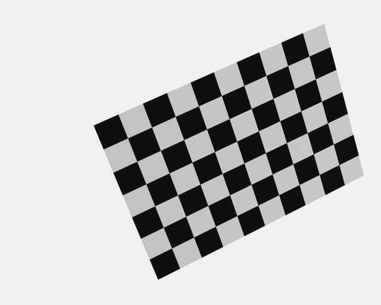

# The command-line pipeline

**Goal:** run the whole closed loop from a script: check a cell, generate its poses, write the
ground truth, calibrate it exactly and with noise, export the motion, then render images with
Blender, detect the board and calibrate from the detections.

The cell is `examples/closed_loop_ur5e`, the same as in
[Your first synthetic dataset](first_dataset.md). Everything here is what the desktop app does
behind its buttons.

## What you need

- **The `etendue` command** on your `PATH` (see [Installation](../installation.md)).
- **A source checkout** to run from: the commands use the `examples/` folder and the robot
  models in `assets/robots`. From a checkout, `cargo run --release -p etendue-cli -- <command>`
  is the same as `etendue <command>`.
- **Blender 5.2** and the robot meshes for steps 7 to 9 only. etendue finds Blender through
  `--blender`, then `ETENDUE_BLENDER`, then the platform's default
  (`/Applications/Blender.app/Contents/MacOS/Blender` on macOS, `blender` on the `PATH`
  elsewhere). The checkout's `etendue.toml` pins the version to 5.2.x.

Run every command from the checkout's root. All output goes under `target/pipeline`.

## The script

Steps 1 to 6 need no Blender and run in a few seconds:

```bash
#!/usr/bin/env bash
set -euo pipefail

CELL=examples/closed_loop_ur5e
OUT=target/pipeline
mkdir -p "$OUT"

# 1. Check the cell
etendue validate "$CELL/scene.json" "$CELL/scenario.json"

# 2. Regenerate the poses from the scenario's own generator
etendue scenario sphere "$CELL/scene.json" --spec "$CELL/scenario.json" \
  -o "$OUT/scenario.json" --candidates "$OUT/candidates.json"

# 3. Write the ground truth
etendue gt "$CELL/scene.json" "$OUT/scenario.json" -o "$OUT/dataset"

# 4. Calibrate the exact observations: must pass
etendue calibrate "$OUT/dataset" -o "$OUT/exact.json"

# 5. Calibrate with 0.1 px of corner noise, 8 trials, and keep the run
echo '{ "pixel_sigma_px": 0.1, "seed": 1 }' > "$OUT/noise.json"
etendue calibrate "$OUT/dataset" --noise "$OUT/noise.json" --trials 8 \
  -o "$OUT/noise_report.json" --run "$OUT/runs/noise-s1x8"

# 6. Export the motion for the controller
etendue export "$CELL/scene.json" "$OUT/scenario.json" \
  --captures "$OUT/captures.csv" --trajectory "$OUT/trajectory.csv" \
  --report "$OUT/motion_report.json" --resolved "$OUT/resolved.json"
```

Steps 7 to 9 render, detect and calibrate again:

```bash
# 7. Render every capture with Blender (minutes)
etendue render "$CELL/scene.json" "$OUT/scenario.json" -o "$OUT/dataset" \
  --supersample 4 --samples 16 --sensor "$CELL/sensor_linear.json"

# 8. Detect the board in every image
etendue detect "$OUT/dataset"

# 9. Calibrate from the detections
etendue calibrate "$OUT/dataset" --features "$OUT/dataset/features.json" \
  -o "$OUT/detected.json"
```

The rest of this page goes through each step and what it prints.

## Steps

### 1. Validate the cell

```text
scene ok: 1 robot(s), 1 rig(s), 2 camera(s), 0 laser(s), 0 light(s), 1 target(s), 0 part(s)
scenario ok: 48 step(s), 22.440 s, 2245 sample(s) at dt = 0.01 s, 24 capture(s)
```

`validate` loads the robot models, resolves the frame tree, and compiles the scenario in full:
every pose must be reachable and every move within the joint limits. A problem is printed with
where it is, and the command fails.

### 2. Generate the poses

The example's `scenario.json` keeps the generator spec that made it, under `generator`, so
`--spec` can take the scenario itself:

```text
24 of 48 candidate poses kept, 22.44 s of motion → target/pipeline/scenario.json
```

The result is the example's scenario again: the same 24 poses. `--candidates` writes all 48
candidates with the reason each was kept or not. Half are `not_visible`: for example, at one of
them `cam_left` sees only 52 of the board's 54 corners. To try another plan, copy the
`generator` object into a file of its own, change it (radii, angle ranges and steps, rolls,
the share of the board each camera must see) and pass that file to `--spec`.

### 3. Write the ground truth

```text
ground truth: 24 capture(s), 48 view(s), 2592 visible point(s) of 54 → target/pipeline/dataset
```

The dataset folder holds `dataset.json` (calibration-rs's dataset), `robot_poses.json` (the
tool pose at every capture) and `gt.json` (the true cameras, rig, hand-eye and target). No image
is needed yet: the observations are the analytic projections of the board's corners.

### 4. Calibrate the exact observations

```text
target/pipeline/dataset: rig hand-eye (2 camera(s): cam_left, cam_right; 24 views, 2592 points, 0 laser pixels)
  mean reprojection px             7.676e-7  ≤ 0.05     PASS
  cam_left fx rel                 1.489e-10  ≤ 0.0001   PASS
  cam_left fy rel                  7.540e-11  ≤ 0.0001   PASS
  cam_left cx px                   5.505e-6  ≤ 0.05     PASS
  cam_left cy px                  1.819e-12  ≤ 0.05     PASS
  …
  hand-eye rotation deg            1.528e-7  ≤ 0.01     PASS
  hand-eye translation mm          1.330e-6  ≤ 0.05     PASS
  …
  closed-loop check (target): PASS
  reprojection: mean 0.0000 px, rms per axis 0.0000 px over 2592 points
```

Each row is a quantity's error against the truth. On exact observations, the rows with a limit
are checked: mean reprojection error ≤ 0.05 px, focal lengths within 0.01 %, principal point
≤ 0.05 px, hand-eye within 0.01° and 0.05 mm (and, with lasers, each laser plane within 0.01° and
0.05 mm). The summary line reads PASS when all are within; otherwise the command fails, so a
script with `set -e` stops there. The whole calibration took half a second.

### 5. Calibrate with noise

`--noise` takes a JSON object; every field is optional and defaults to 0: `pixel_sigma_px`,
`outlier_fraction` and `outlier_sigma_px`, `dropout_fraction`, `laser_sigma_px`,
`robot_rot_sigma_rad`, `robot_trans_sigma_m` and `seed`. With 0.1 px of pixel noise and
`--trials 8` (seeds 1 to 8), it prints the first trial's rows, then each row's spread:

```text
8 trials:
  mean reprojection px         mean   1.228e-1  std   1.692e-3  max   1.258e-1
  cam_left fx rel              mean   4.944e-4  std   2.818e-4  max   1.014e-3
  cam_left cx px               mean    1.141e0  std   6.225e-1  max    2.090e0
  …
  hand-eye rotation deg        mean   4.128e-2  std   1.864e-2  max   7.401e-2
  hand-eye translation mm      mean   2.722e-1  std   1.439e-1  max   5.576e-1
```

On noisy input the limits are shown for reference, not checked, and the command succeeds. Here
0.1 px of noise moves the principal point by about a pixel and the hand-eye by about 0.3 mm:
that is the precision this pose plan gives. The same seed always gives the same numbers. The 8
trials took about 10 seconds.

`--run` keeps the run in a folder of its own: `config.json` (the dataset and the options),
`report.json`, and calibration-rs's own export of the first trial as `result.json`. The studio
lists such runs (a project keeps them in its `runs/` folder).

`--camera cam_left` would calibrate one camera of the rig alone.

### 6. Export the motion

```text
24 capture(s) of `ur5e` → target/pipeline/captures.csv
2245 sample(s) of `ur5e` → target/pipeline/trajectory.csv
motion report (22.44 s, 0 warning(s)) → target/pipeline/motion_report.json
resolved scenario → target/pipeline/resolved.json
```

`captures.csv` has one row per capture, in the robot's base frame and SI units:

```text
capture,t,x,y,z,qx,qy,qz,qw,rx,ry,rz,shoulder_pan_joint,shoulder_lift_joint,elbow_joint,wrist_1_joint,wrist_2_joint,wrist_3_joint
s1_t1_p2_r1,1.16,0.30484615773071,0.3561963530405527,0.5211409725370977,…
```

`trajectory.csv` has one row per 10 ms sample: `t`, the capture id on capture samples, then each
joint's position (`q_`), velocity (`qd_`) and acceleration (`qdd_`). `resolved.json` is the
scenario with every move's joint configuration stored, so it compiles to the same arm
configurations every time.

### 7. Render

```text
rendering 48 image(s) with Blender 5.2.2: 24 shot(s) × 2 camera(s), 16 samples
…
wrote 48 image(s) under target/pipeline/dataset/images
```

`render` writes into the dataset folder: `job.json` (what Blender was asked to render), `exr/`
(Blender's canonical renders, with depth) and `images/<camera>/<capture>.png`, each remapped onto
the camera's own model. `--supersample 4` renders four canonical pixels per camera pixel (at
the image centre), which corner accuracy needs; `--samples 16` is Cycles' samples per pixel; `--sensor` applies the
example's sensor model, so the images are linear raw 8-bit greyscale.

These 48 images took about 3.5 minutes on an Apple-silicon Mac's GPU (9 minutes while the
machine was busy with other work). There is no flag to render only
some captures; to try the pipeline quickly, render one camera (`--camera cam_left`) or generate a
smaller scenario first (fewer steps in the generator spec).



### 8. Detect the board

```text
| camera | views ok | no board | partial | ambiguous | undecoded | points | mislabelled | unmatched | off board | RMS vs GT px | max px |
|---|---|---|---|---|---|---|---|---|---|---|---|
| cam_left | 24/24 | 0 | 0 | 0 | 0 | 1296 | 0 | 0 | 0 | 0.0578 | 0.1374 |
| cam_right | 24/24 | 0 | 0 | 0 | 0 | 1296 | 0 | 0 | 0 | 0.0583 | 0.1372 |
features → target/pipeline/dataset/features.json
```

Every board was found, every corner labelled correctly, and the detected corners sit 0.058 px
(RMS) from their true pixels, 0.14 px at worst. The detector never uses the truth to find or
label a corner; the truth only scores it.

### 9. Calibrate from the detections

```text
  mean reprojection px             5.207e-2  ≤ 0.05     outside
  cam_left fx rel                  1.899e-4  ≤ 0.0001   outside
  cam_left cx px                   2.747e-1  ≤ 0.05     outside
  cam_left cy px                   1.828e-2  ≤ 0.05
  …
  hand-eye rotation deg            1.154e-2  ≤ 0.01     outside
  hand-eye translation mm          1.409e-1  ≤ 0.05     outside
  reprojection: mean 0.0521 px, rms per axis 0.0404 px over 2592 points
```

Detected corners are not exact, so the limits are for reference: a row marked "outside" is not a
failure. This is the realistic result: with images as good as these, the calibration recovers
the focal lengths within 0.02 %, the principal point within 0.3 px, and the hand-eye within
0.012° and 0.14 mm.

## What you should see

| Step | Result |
|---|---|
| poses | 24 of 48 candidates kept, 22.44 s of motion |
| ground truth | 24 captures, 48 views, 2592 points |
| exact calibration | PASS, every error far below its limit |
| 0.1 px noise, 8 trials | principal point about 1 px off, hand-eye about 0.04° and 0.3 mm |
| render and detect | 48 images, all corners found, 0.058 px RMS from the truth |
| calibration from detections | hand-eye within 0.012° and 0.14 mm |

## Next steps

- [Command line](../cli.md): every command and flag.
- [Datasets](../datasets.md) and [File formats](../formats.md): the files each step writes.
- [Rendering](../rendering.md): the render settings and the sensor model.
- [Calibration](../calibration.md): the workflows and the report.
- [Ground truth and closed-loop calibration](../models/closed_loop.md) and
  [Synthetic images](../models/synthetic_images.md): how the truth and the images are made.
