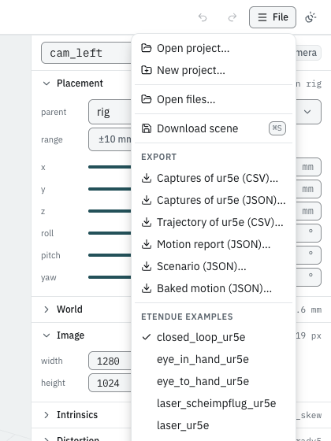
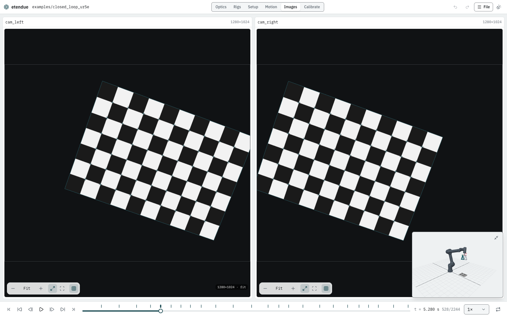
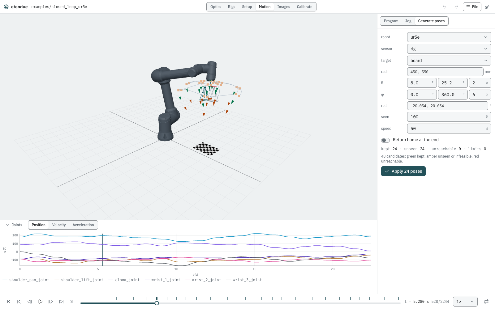
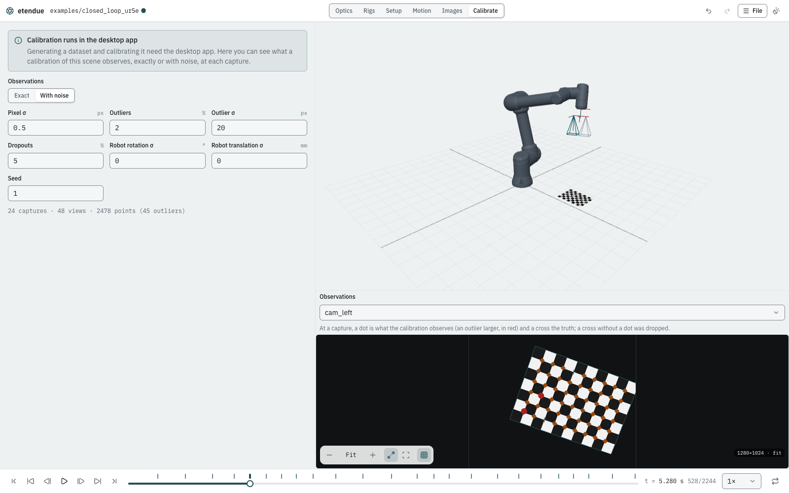

# Your first synthetic dataset

**Goal:** take a robot-mounted stereo rig, plan its calibration poses, render a synthetic
dataset, calibrate it, and check that the calibration recovers the truth.

The cell is the `closed_loop_ur5e` example: a UR5e carries a two-camera rig on its flange and
looks down at a 9×6 chessboard with 20 mm squares. etendue knows every camera, pose and pixel of
this cell exactly, so a calibration of its images can be compared with the truth.

## What you need

- **The desktop app** to generate the dataset and calibrate it (see
  [Installation](../installation.md)).
- **Blender 5.2** to render images. Without it you can still write the ground truth and calibrate
  from it (step 4 says how).

Steps 1 to 3 also work in the studio in a browser. There, the **Calibrate** workspace only
previews what a calibration would observe (step 6).

## Steps

### 1. Open the example

1. Open the **File** menu at the top right.
2. Under **etendue examples** (the list of cells at the bottom of the menu), choose
   **closed_loop_ur5e**.



The header now shows `examples/closed_loop_ur5e`. The scene tree on the left holds the robot
`ur5e`, its flange `tool0`, the `rig` with `cam_left` and `cam_right`, and the target `board`.
The inspector on the right summarises the cell: 1 robot, 2 cameras, 1 target, a scenario of
22.44 s with 24 captures.

### 2. Play the scenario

1. Press the play button in the playback bar along the bottom. The robot moves from pose to
   pose and stops at each capture.
2. Each tick on the timeline is a capture. Click the fifth tick: the playhead jumps to it
   (`t = 5.280 s`, sample 528 of 2244).
3. Switch to the **Images** workspace in the header. It shows what both cameras see at the
   playhead, with the board's corners projected through each camera's model.



### 3. Generate the calibration poses

The example's scenario was made by the sphere pose generator, and keeps its settings. You can
open them, change them and generate the poses again.

1. Switch to the **Motion** workspace.
2. In the panel on the right, choose **Generate poses**.

The form shows the example's settings:

| Field | Value | Meaning |
|---|---|---|
| robot | `ur5e` | the robot that moves |
| sensor | `rig` | the frame that must look at the target |
| target | `board` | what it looks at |
| radii | 450, 550 mm | distances from the board's centre |
| θ | 8.0° to 25.2°, 2 steps | tilt away from straight above the board |
| φ | 0° to 360°, 6 steps | directions around the board |
| roll | −20.054°, 20.054° | turns of the rig about its viewing axis |
| seen | 100 % | each camera must see every corner of the board |
| speed | 50 % | the moves use half of the robot's limits |

That is 2 × 2 × 6 × 2 = 48 candidate poses. The summary below the form reads
**kept 24 · unseen 24 · unreachable 0 · limits 0**, "48 candidates". In the 3D view the kept
poses are green. The amber ones are poses where a camera does not see the whole board (with a
2 px margin), or where the arm would come too close to a joint limit or a singularity. A red one
would be out of the robot's reach.



3. Try a change: set the φ steps to 4. The summary updates at once (32 candidates). Set it back
   to 6.
4. Click **Apply 24 poses**. The program becomes 24 point-to-point moves, each followed by a
   capture, and each move stores its joint configuration (the pin icon in the **Program**
   list), so the arm always takes the same branch. **Undo** in the header takes it back.

The program reads `22.44 s · 24 captures · 0 warnings`: the same poses as the example.

### 4. Generate the dataset (desktop app)

1. Switch to the **Calibrate** workspace.
2. Check the line at the top: it should read **Blender 5.2.x**. If it reads
   **Blender not found**, **Generate** stays disabled while rendering is on; see
   [Installation](../installation.md).
3. Leave the settings as they are:

| Setting | Value |
|---|---|
| Output folder | `Documents/etendue/closed_loop_ur5e` (the default for a built-in example) |
| Render with Blender | on |
| Samples | 16 |
| Supersampling | 4 |
| Sensor model | the example's `sensor_linear.json`: linear raw images |
| Cameras | `cam_left` and `cam_right` |
| Render on the CPU | off |

4. Click **Generate**. The progress bar goes through the ground truth, the rendering, the
   resampling onto each camera, and the detection. **Cancel** stops it.

The run renders 48 images (24 captures × 2 cameras). With these settings the same render took
about 3.5 minutes on an Apple-silicon Mac's GPU (timed with the command line, which runs the
same pipeline).

Without Blender, turn **Render with Blender** off: **Generate** then writes only the ground
truth (`dataset.json`, `gt.json` and `robot_poses.json`), in a second. You can still calibrate
it with **Exact** or **With noise** observations below.

When the run ends, the table **Detection against the ground truth** gives, per camera:

| Column | What you should see | Meaning |
|---|---|---|
| Views ok | 24/24 | the board was found in every image |
| Corners | 1296 | 24 views × 54 inner corners |
| Mislabelled | 0 | no corner got another corner's label |
| RMS vs GT | about 0.058 px | how far the detected corners are from their true pixels |
| Max | about 0.14 px | the worst corner |

Back in **Images**, each camera now has a **Dataset image (Blender)** button in its toolbar:
it shows the rendered image at the capture instead of the live view.

### 5. Calibrate and compare (desktop app)

Below the dataset settings, **Calibrate and compare** runs calibration-rs on the dataset and
compares every result with the truth.

1. Set **Observations** to **Exact**: the ground truth's own pixels, with no noise at all.
2. Click **Calibrate**.

The result's first line reads **rig hand-eye**, `cam_left, cam_right · 24 views · 2592 points`,
with a **PASS** badge. The table lists every quantity's error against the truth. A row with a
limit shows **PASS** or **FAIL**:

| Quantity | Limit | What it checks |
|---|---|---|
| mean reprojection px | ≤ 0.05 px | the calibrated model reproduces the observed corners |
| fx rel, fy rel | ≤ 0.0001 | each focal length within 0.01 % of the truth |
| cx px, cy px | ≤ 0.05 px | the principal point |
| hand-eye rotation deg | ≤ 0.01° | the rig's pose on the flange |
| hand-eye translation mm | ≤ 0.05 mm | the same, in position |

The other rows (distortion coefficients, the right camera's pose in the rig, the board's pose)
are shown without a limit. With exact observations everything should come back almost
perfectly. These are the errors this run gave:

```text
  mean reprojection px             7.676e-7  ≤ 0.05     PASS
  cam_left fx rel                 1.489e-10  ≤ 0.0001   PASS
  cam_right cx px                  7.220e-4  ≤ 0.05     PASS
  hand-eye rotation deg            1.528e-7  ≤ 0.01     PASS
  hand-eye translation mm          1.330e-6  ≤ 0.05     PASS
```

**What pass and fail mean.** These limits only apply to exact observations. A pass shows that
the cell, its ground truth and the calibration agree: the poses constrain every parameter, and
nothing in the chain is inconsistent. A fail on exact input means something is wrong: poses
that leave a parameter unconstrained, or a mismatch between the scene and what was calibrated.

Now try noise:

1. Set **Observations** to **With noise**.
2. Set **Pixel σ** to 0.1, **Seed** to 1 and **Trials** to 8. Leave the other fields as they
   are (no outliers, dropouts or robot noise).
3. Click **Calibrate**.

The table now gives each quantity's **Mean**, **Std** and **Max** over the 8 trials. The limits
are shown for reference only. Noise of 0.1 px per axis gives, for example:

| Quantity | Mean | Max |
|---|---|---|
| mean reprojection px | 0.123 | 0.126 |
| cam_left fx rel | 4.9e-4 | 1.0e-3 |
| cam_left cx px | 1.14 | 2.09 |
| hand-eye rotation deg | 0.041 | 0.074 |
| hand-eye translation mm | 0.27 | 0.56 |

So even a tenth of a pixel of corner noise moves the principal point by around a pixel and the
hand-eye by about a quarter of a millimetre, with these 24 poses. This is how you judge a pose
plan: how far the result moves under the noise you expect. The same seed always gives the same
numbers.

After the render, a third choice appears: **Detected**, the detector's corners from the rendered
images. With it this dataset gave a mean reprojection error of 0.052 px, focal lengths within
0.02 %, and the hand-eye within 0.012° and 0.14 mm.

Every run is kept. Below the result, the dataset's runs are listed newest first, each with what
it calibrated from and how it came out; **Show** brings one back. A run's folder is named after
the dataset, the time and the observations, for example
`closed_loop_ur5e-20261020-091522-noise-s1x8`, and holds `config.json`, `report.json` and
calibration-rs's own `result.json`.

Next to the panel, the 3D view draws the estimated cameras over the true ones in the warning
colour, with the errors exaggerated (×1 to ×1000), and the camera view below shows the
observations at each capture.

### 6. In a browser: preview the observations

In a browser, the **Calibrate** workspace shows the note **Calibration runs in the desktop
app**. You can still see exactly what a calibration of this cell observes:

1. Choose **Exact**: the panel totals `24 captures · 48 views · 2592 points`.
2. Choose **With noise**, and set **Outliers** to 2 % and **Dropouts** to 5 % (with the default
   **Pixel σ** of 0.5 px and **Seed** 1). The totals become
   `24 captures · 48 views · 2478 points (45 outliers)`.
3. Click a capture on the timeline. In the camera view below the 3D view, each dot is an
   observed corner, a larger red dot is an outlier, and each cross is the truth: a cross with no
   dot was dropped.



These are the same points, from the same seeded noise, that the desktop app calibrates from.

## What you should see

- 48 candidate poses, 24 kept; a program of 22.44 s with 24 captures.
- A dataset of 48 images, with every corner found and labelled, about 0.06 px from the truth.
- On exact observations: **PASS**, with errors many orders of magnitude below the limits.
- With 0.1 px noise over 8 trials: a principal point about 1 px off on average, and the
  hand-eye about 0.04° and 0.3 mm off.

## Next steps

- [The studio](../studio.md): every workspace and panel.
- [Calibration](../calibration.md): the workflows, the noise model and the report.
- [Datasets](../datasets.md) and [Rendering](../rendering.md): the files written, and the render
  settings.
- [Pose generation](../models/poses.md) and
  [Ground truth and closed-loop calibration](../models/closed_loop.md): how the poses and the
  truth are made.
- [The command-line pipeline](cli_pipeline.md): the same run as a script.
