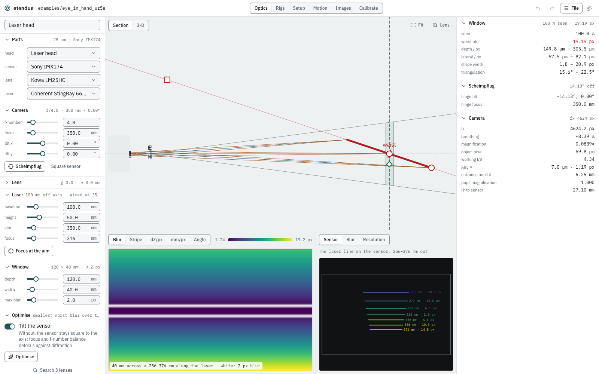
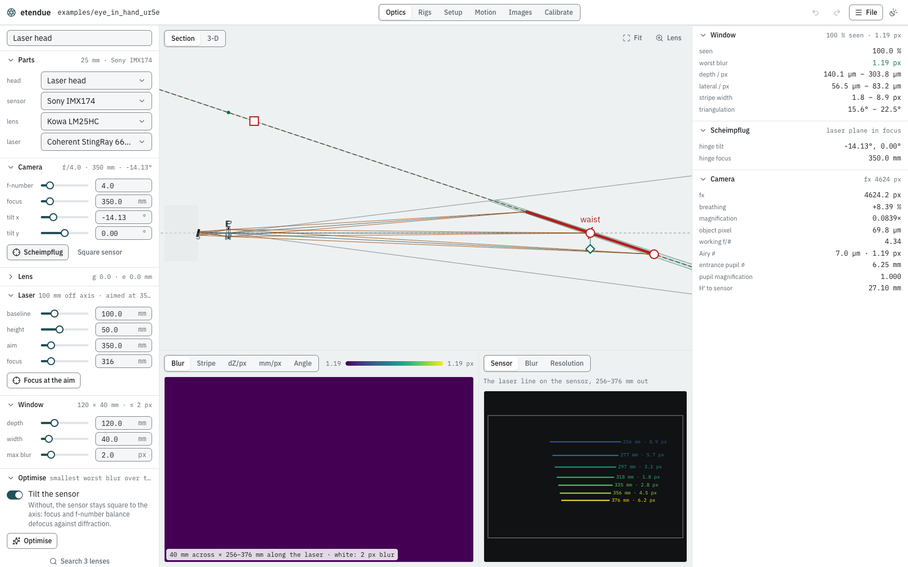
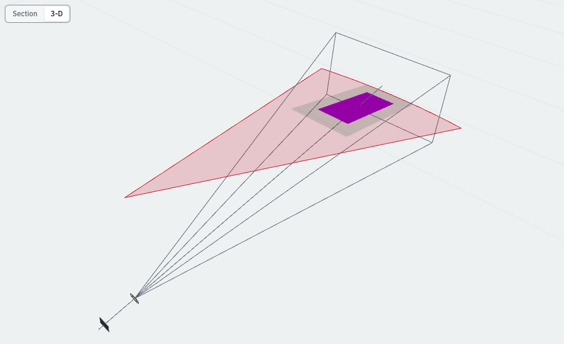
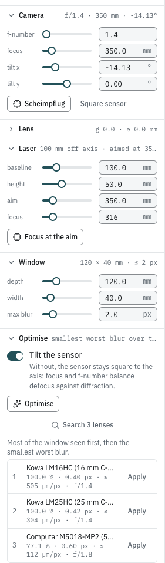

# Design a laser-triangulation head

**Goal:** design a camera and a line laser on one body so that the laser stripe stays sharp
over the whole range you must measure, then save the design to your library.

You will start from a plain head (an untilted camera focused at the aim point) and see why it
fails, put the laser plane in focus with a Scheimpflug tilt, let the optimiser and the lens
search improve it, and read what the result gives in depth resolution.

## What you need

- **The studio**, in the desktop app or a browser. Everything here runs in the browser kernel.
- **A project you can write to**, only for the last step (saving to the library). The examples
  are read-only.

## Steps

### 1. Open the Optics workspace

1. Open any cell (the examples are fine: the Optics workspace works on the project's library,
   not on the cell).
2. Choose **Optics** in the header.

The left panel, **Design**, holds the head. The centre shows the **Section** through the camera
axis and the laser plane, and below it the laser plane as a map and the line along the laser.
The right panel lists the figures.

### 2. Choose the parts

Under **Parts**:

- **head**: the design you start from. **Laser head** is the starting design.
- **sensor**, **lens**, **laser**: each lists the parts of the project's library. The starting
  head uses a **Sony IMX174** sensor (5.86 µm pixels, 1936×1216), a **Kowa LM25HC** 25 mm lens
  and a **Coherent StingRay 660-30** red line laser.

Keep these for now. The **Lens** section (folded) shows the lens's focal length, principal-plane
gap and entrance-pupil position; the library fills them in.

### 3. Place the laser and set the window

Under **Laser**, the laser sits **baseline** 100 mm off the camera axis, **height** 50 mm along
it (from the camera's image-plane datum), and its central ray crosses the axis at **aim** 350 mm.
Its **focus** is where the beam's waist is, 316 mm along the ray: the StingRay is focusable, so
the design focuses it at the aim point. **Focus at the aim** puts it back there after a change.

Under **Window**, the head must measure over a **depth** of 120 mm along the laser and a
**width** of 40 mm along its line, centred on the aim point, with at most **max blur** 2 px. The
window therefore runs from 256 mm to 376 mm along the laser (the map's caption says so).

You can also drag these in the section: the handles move the camera's focus, the aim, the laser
and the window's depth. **Lens** zooms onto the camera, **Fit** shows everything, the wheel
zooms and a drag pans.

### 4. Read the starting design

Under **Camera**, the lens is at f/4 and focused at 350 mm, with the sensor square to the axis
(**tilt x** and **tilt y** 0°). The figures on the right:

| Figure | Value | Meaning |
|---|---|---|
| seen | 100.0 % | the whole window is in the camera's view |
| worst blur | 19.19 px | defocus and diffraction together, at the worst point of the window |
| depth / px | 149.8 µm – 305.5 µm | how far the surface moves along the laser for the stripe to move one pixel |
| lateral / px | 57.5 µm – 82.1 µm | the size of a pixel along the laser line |
| stripe width | 1.8 – 20.9 px | the imaged width of the stripe, beam and blur together |
| triangulation | 15.6° – 22.5° | the angle between the laser and the camera's line of sight |

The blur limit is 2 px and the worst blur is almost ten times that. The **Map** (bottom left,
**Blur**) shows why: only a band of the window across the middle is sharp, inside the white
contour of the 2 px limit. The camera is focused on a plane square to its axis, but the laser
plane is inclined to it, so the stripe goes out of focus towards the window's near and far ends.
Under **Along the laser**, **Sensor** draws the laser line on the image at seven ranges: its width
grows from 1.8 px in the middle to 20.9 px at the near end.

The **Scheimpflug** figures say what would fix it: the sensor is **14.13° off** the tilt that
puts the laser plane in focus (**hinge tilt** −14.13°, **hinge focus** 350.0 mm).

### 5. Try the optimiser with a square sensor

What is the best you can do without tilting? Under **Optimise**, turn **Tilt the sensor** off
and click **Optimise**. It searches the focus and the f-number for the smallest worst blur
over the window, from the current design, and offers the result:

- **start 19.19 → 6.25 px**, at 0.00°, 0.00° · 340.0 mm · f/14.8.

Stopping down to f/14.8 widens the depth of field but makes the Airy disc 4.42 px, and the
window is still three times over its blur limit. Click **Discard**, and turn **Tilt the
sensor** back on.

### 6. Tilt the sensor: the Scheimpflug condition

Click **Scheimpflug**. The sensor tilts by −14.13° about x and the camera focuses so that its
plane of best focus is the laser plane.

- **worst blur** drops to **1.19 px**, and the Scheimpflug figure reads **laser plane in focus**.
- 1.19 px is exactly the camera's **Airy ⌀** (7.0 µm, 1.19 px at f/4): with no defocus left,
  only diffraction remains.
- The stripe's width is now 1.8 – 8.9 px. What is left is mostly the laser beam's own thickness,
  which grows away from its waist.

**3-D** above the section shows the same head to scale in 3-D: the tilted sensor, the lens, the
camera's field, the laser's fan, and the window on the laser plane, coloured by blur.

### 7. Optimise with the tilt

With **Tilt the sensor** on, click **Optimise** again. It now also searches the tilt, from the
Scheimpflug design:

- **start 1.19 → 0.42 px**, at −14.13°, 0.00° · 350.0 mm · f/1.4.

With the laser plane in focus there is no defocus to trade against, so the optimiser opens the
aperture to shrink the Airy disc. Click **Apply**.

etendue's lens is ideal: its blur is defocus and diffraction, and it does not model aberrations,
which grow as a real lens opens up. Treat a result at the lens's widest aperture with care, and
set the f-number back to one you trust if you need to.

### 8. Search the library's lenses

Click **Search 3 lenses**. Every lens of the library is fitted to the head and optimised the same
way, then ranked: the most of the window seen first, then the smallest worst blur.

| Lens | Seen | Worst blur | Coarsest depth / px | f-number |
|---|---|---|---|---|
| Kowa LM16HC (16 mm) | 100.0 % | 0.40 px | ≤ 505 µm/px | f/1.4 |
| Kowa LM25HC (25 mm) | 100.0 % | 0.42 px | ≤ 304 µm/px | f/1.4 |
| Computar M5018-MP2 (50 mm) | 77.1 % | 0.60 px | ≤ 112 µm/px | f/1.8 |

The 16 mm lens wins on blur, but each of its pixels covers 505 µm of depth at the far end, against
304 µm for the 25 mm lens. The 50 mm lens resolves depth best but sees only 77 % of the window.
**Apply** takes a lens with its setting. Here the 25 mm lens is the balance: keep it.

### 9. Read the views

- **Map** (bottom left), the laser plane over the window, face on: **Blur** (total blur),
  **Stripe** (the stripe's width), **dZ/px** (depth per pixel), **Lateral/px** (lateral resolution)
  and **Angle** (triangulation angle). Hatched samples are out of view; the white contour is the
  blur limit.
- **Along the laser** (bottom right): **Sensor** (the line on the image at seven ranges, each
  labelled with its range and width), **Blur** (blur and stripe width against range, on the
  line's centre and the worst across it, with the limit and a tick where the laser is focused),
  and **Resolution** (depth and lateral resolution against range).
- **Camera** (right): the derived optics: fx (4624.2 px here) and how much it changes with focus
  (**breathing**), magnification, the size of a pixel on the object, the working f-number, the
  Airy disc and the pupils.

### 10. Save the head

Under **Library** (at the bottom of the Design panel):

1. Check the head's **id**: `laser_head` by default. It names the file.
2. Click **Save to library**. It writes `library/heads/laser_head.json` in the open project.
   With an example open, the panel says the examples are read-only: open or create a project
   first (**File › Open project…** or **New project…**).
3. **Place in cell** adds the head's camera and laser to the open cell, as one undoable edit,
   and switches to **Setup**, where they appear as `head_cam` and `head_laser`.

## What you should see

- The starting head: worst blur 19.19 px over a window of 120 × 40 mm, far over its 2 px limit.
- Square sensor, optimised: 6.25 px at f/14.8, still over the limit.
- Scheimpflug tilt of −14.13°: 1.19 px, the diffraction limit at f/4; optimised, 0.42 px.
- Depth resolution of 140 – 304 µm per pixel with the 25 mm lens.

## Next steps

- [The studio](../studio.md): the Optics workspace's panels in full.
- [Projects and the library](../library.md): where the parts and the saved head live.
- [Physical cameras and the thick lens](../physical_cameras.md),
  [Defocus and the blur budget](../models/blur.md) and
  [Scheimpflug plane of best focus](../scheimpflug.md): the optics behind the figures.
- [Laser line and stripe](../laser.md) and [Triangulation heads](../models/heads.md): the stripe's
  width, depth per pixel, and how the optimiser works.
- [Lay out a multi-camera rig](rig_layout.md): repeat this head around a ring.
