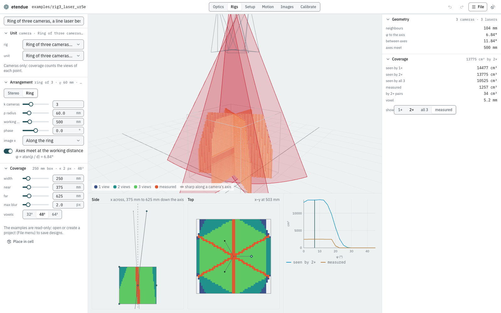
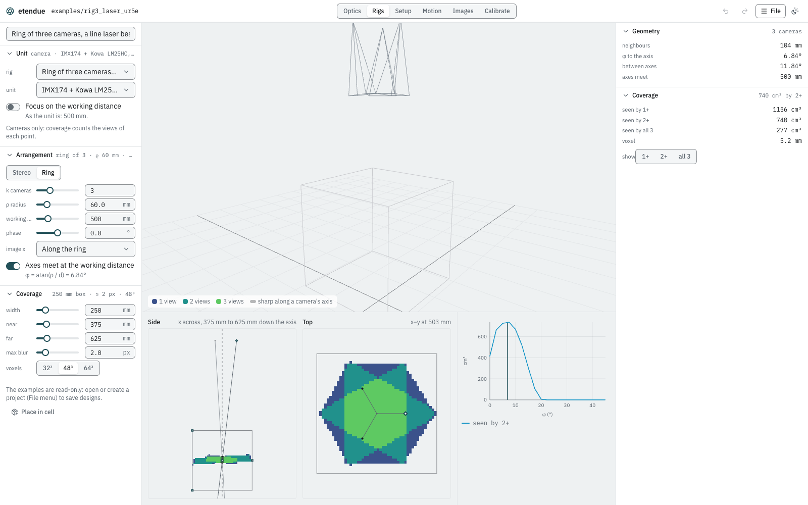

# Lay out a multi-camera rig

**Goal:** lay out a ring of cameras (with a line laser beside each) and find out how much of the
measuring volume they see, see sharply, and can measure with their lasers.

You will start from a stereo pair, load the three-camera laser ring that the `rig3_laser_ur5e`
example uses, read its coverage, then swap in a physical camera and see the depth of field cut
the volume down.

## What you need

- **The studio**, in the desktop app or a browser.
- **A project you can write to**, only to save the rig to the library.

## Steps

### 1. Open the example and the Rigs workspace

1. **File › rig3_laser_ur5e.** This cell has a ring of three cameras on the UR5e's flange,
   converging 0.5 m ahead, with one line laser per camera. In **Images**, each camera shows its
   own laser's stripe on the board, and not the other two.
2. Choose **Rigs** in the header.

The Rigs workspace works on the project's library, not on the cell: it repeats one unit (a
camera, or a head with its laser) around a layout, and judges the layout over a box. It starts
with a **Stereo pair** of the library's **IMX174 + Kowa LM25HC, f/4, focused at 0.5 m**.

Read the stereo pair's figures on the right before you change anything:

| Figure | Value |
|---|---|
| baseline | 120 mm |
| φ to the axis | 8.53° (each camera turned in) |
| axes meet | 400 mm |
| seen by 1+ / 2+ / all 2 | 451 / 101 / 101 cm³ |
| voxel | 4.2 mm |

"Seen" means seen **sharply**: a voxel counts for a camera when it is in the camera's view and
the camera's blur there is under the **max blur** (2 px).

### 2. Load the example's ring

Under **Unit**, set **rig** to **Ring of three cameras, a line laser beside each**. It is the
library copy of `rig3_laser_ur5e`'s rig. The **Arrangement** switches to **Ring**:

| Field | Value | Meaning |
|---|---|---|
| k cameras | 3 | cameras around the ring |
| ρ radius | 60 mm | the ring's radius |
| working dist. | 500 mm | where the axes meet, along the rig's axis |
| phase | 0° | the ring's rotation about its axis |
| image x | Along the ring | each image's x runs tangentially |
| Axes meet at the working distance | on | φ = atan(ρ / d) = 6.84° |

Under **Coverage**, the box is 250 mm wide, from 375 mm (**near**) to 625 mm (**far**) along
the axis, with a 2 px blur limit, on a 48³ voxel grid.

The figures:

| Figure | Value | Meaning |
|---|---|---|
| neighbours | 104 mm | distance between neighbouring cameras |
| between axes | 11.84° | angle between neighbours' axes |
| seen by 1+ | 14477 cm³ | seen by at least one camera |
| seen by 2+ | 13775 cm³ | seen by at least two |
| seen by all 3 | 10525 cm³ | seen by every camera |
| measured | 1257 cm³ | on a laser plane and seen by that laser's own camera |
| by 2+ pairs | 34 cm³ | measured by at least two laser–camera pairs |

The box holds 15625 cm³, so nearly all of it is seen: this rig's camera is the examples' plain
pinhole model, which has no depth of field, so only the field of view limits it.

Under **show**, choose **measured** to see the measured voxels in the 3D view: three sheets,
one per laser plane, crossing the box.

A laser plane has no thickness, so **measured** counts the voxels it passes through. It shrinks
as the grid gets finer (947 cm³ at **64³**, where a voxel is 3.9 mm), while the "seen" volumes
barely change. Compare designs on the same grid.

### 3. Read the slices and the tilt chart

Below the 3D view:

- **Side**: the coverage through the rig's axis, x across and 375 mm to 625 mm down the axis.
  The cameras' axes are drawn; a band on each axis marks where that camera is sharp.
- **Top**: across the axis at the working distance (x–y at 503 mm, the voxel layer nearest
  500 mm), with the cameras around the ring. With **measured** shown, the lines are where each
  laser plane crosses the layer.
- The chart beside them: the volume **seen by 2+** and **measured** against the tilt φ, from 0°
  to 45°, with the current tilt marked. Here, seen by 2+ stays near its maximum up to φ ≈ 15°
  and falls to nothing by about 25–30°; measured falls to nothing by about 20°. Turning the
  cameras in further would cost coverage. The chart is computed on a coarse grid (24³) to stay
  fast, so read it for its shape: its values are not the figures' (its measured curve reads
  about twice the 1257 cm³ above).

You can drag in the slices: the working distance, ρ, the box's near, far and width on the side,
and ρ and the phase on the top.

### 4. Swap in a physical camera

Set **unit** to **IMX174 + Kowa LM25HC, f/4, focused at 0.5 m**. The layout stays, but now
each camera has a real lens with a depth of field, and no laser.

| Figure | Pinhole ring | IMX174 + LM25HC ring |
|---|---|---|
| seen by 1+ | 14477 cm³ | 1156 cm³ |
| seen by 2+ | 13775 cm³ | 740 cm³ |
| seen by all 3 | 10525 cm³ | 277 cm³ |

At f/4 and 2 px, each camera's sharp range is only a few centimetres deep around 500 mm, so
the sharp volume is a slab across the box. The side slice's bands show each camera's sharp range along its
axis.

**Focus on the working distance** refocuses every camera where its axis crosses the working
distance (503.6 mm here, since the axes are tilted by 6.84°). Off, the cameras stay as the unit
is (focused at 500 mm). Turned on, seen by 2+ grows a little, from 740 to 762 cm³.

To get more sharp volume, stop the lens down, accept more blur, or shorten the box.

### 5. A ring of your own head

If you designed a head in [Design a laser-triangulation head](head_design.md), it is offered as
**Laser head (Optics)** under **unit**. Every camera then carries its own laser, fixed to its
body as the head was designed.

The head is focused at 350 mm, so at the ring's 500 mm nothing in the box is sharp and every
volume reads 0. Move the ring to where the head works: **working dist.** 350 mm, **near**
300 mm, **far** 400 mm, **width** 150 mm. With the Scheimpflug head at f/4 (step 6 of that
tutorial), the ring then measures 166 cm³, and 5.74 cm³ is measured by two or more pairs.

### 6. Save the rig or place it

- Give the rig a name (the field at the top of the panel) and click **Save to library**. The
  examples are read-only, so open or create a project first. It writes
  `library/rigs/<id>.json` in the open project, where the id is the one of the rig you started
  from (`ring3_laser` here, `stereo_pair` for the starting pair): saving replaces that item.
  The Rigs workspace has no field to change the id.
- **Place in cell** adds a rig frame with its cameras and lasers to the open cell, as one
  undoable edit, and switches to **Setup**.

A placed rig keeps its layout in the scene: the rig's **Layout** section in the **Setup**
inspector (**cameras**, **radius**, **working distance**, **tilt**, **phase**, **image x**,
**One laser per camera**) edits it, and the cameras and lasers follow. That is how
`rig3_laser_ur5e`'s `rig` is written: a layout of 3 cameras on a 60 mm radius, converging at
0.5 m, with a laser 25 mm from each camera.

## What you should see

- The example's ring sees nearly all of a 250 mm box with pinhole cameras, and its lasers measure
  1257 cm³ of it on a 48³ grid.
- With the IMX174 and a 25 mm lens at f/4, the sharp volume seen by two cameras falls to about
  740 cm³.
- Seen by 2+ holds up to a tilt of about 15° and is gone by about 25–30°.

## Next steps

- [The studio](../studio.md): the Rigs workspace's panels in full.
- [Working volume and rig coverage](../models/coverage.md): how a voxel is judged seen, sharp and
  measured.
- [Defocus and the blur budget](../models/blur.md): where the sharp range comes from.
- [Scenes and scenarios](../scenes.md): a rig layout in a scene file.
- [Projects and the library](../library.md): the saved rig.
