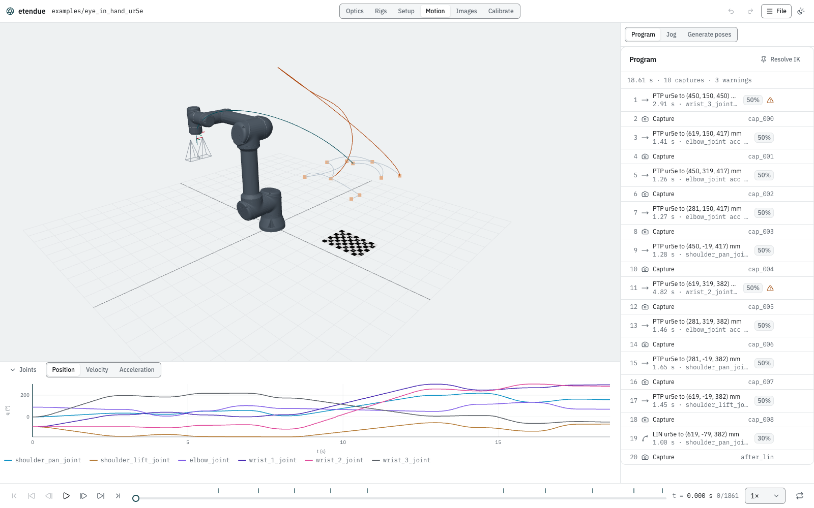
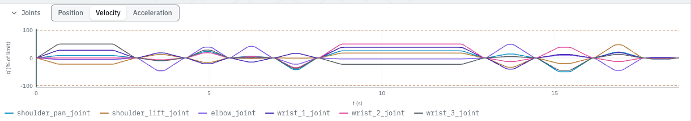
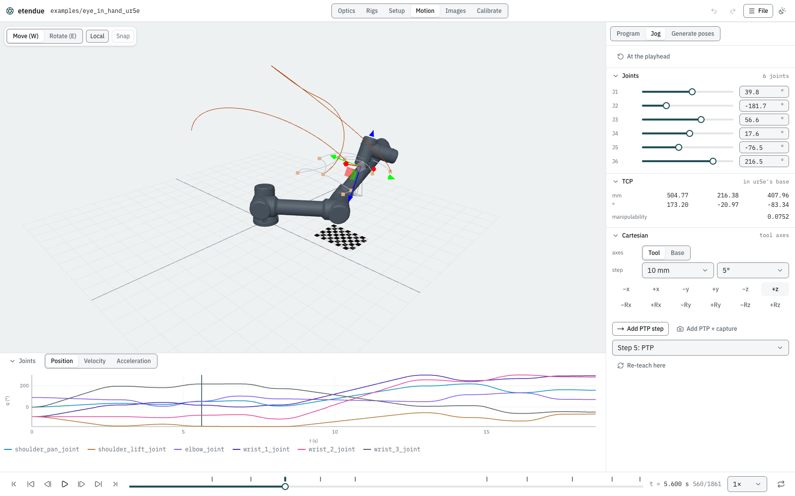

# Program and jog a robot

**Goal:** read a robot program and its motion report, jog the arm to a new pose and teach it,
pin the arm's configurations so the program is repeatable, and export the poses and the
trajectory for a controller.

The cell is the `eye_in_hand_ur5e` example: a UR5e with a stereo rig on its flange, a program of
point-to-point moves to ten captures, and one straight-line move at the end.

## What you need

- **The studio**, in the desktop app or a browser. Everything here runs in the browser kernel.

## Steps

### 1. Open the program

1. **File › eye_in_hand_ur5e.**
2. Choose **Motion** in the header. The panel on the right shows the **Program**.



The line at the top of the program is the motion report's summary:
`18.61 s · 10 captures · 3 warnings`. Each row is a step:

- **PTP ur5e to (450, 150, 450) mm**: a point-to-point move to a tool pose, in the robot's base
  frame. Below it, `2.91 s · wrist_3_joint acc 50%`: the move takes 2.91 s, and the limit that
  sets its time is wrist 3's acceleration, used at 50 %. The **50%** badge is the move's speed
  scale: it may use half of the robot's velocity, acceleration and jerk limits.
- **Capture**, with its id (`cap_000` …): every camera takes an image. Click a capture to move the
  playhead there.
- **LIN ur5e to (619, -79, 382) mm** (step 19): a straight-line tool move, at a 30 % speed scale.

A triangle marks a step with a warning; hover over it to read it. Here:

- step 1: *Passes near a singularity (smallest Jacobian singular value 0.000).*
- step 11: *IK found this pose only from restart 1: the arm may switch branch and swing far.
  Resolve IK to pin it.* It also passes near a singularity.

In the 3D view, the tool's path is drawn over the program, with a dot at every capture. Steps
alternate between two slate tones, a step with a warning is drawn in the warning colour, and the
move at the playhead is in the accent colour. Step 11, the longest move (4.82 s), is one of the
warning-coloured ones. Pointing at the path marks the nearest sample, and a click moves the playhead there.

### 2. Read the joint charts

**Joints**, below the 3D view, plots every joint over the program, with the playhead. Switch it
between **Position**, **Velocity** and **Acceleration**. Every joint of a point-to-point move
starts and stops together, so each move is one smooth bump in the velocity chart.



### 3. Jog the arm

1. Click the third capture (`cap_002`) in the program. The playhead moves to `t = 5.600 s`.
2. Choose **Jog** at the top of the panel. Choosing it pauses playback.

The arm starts where the program has it at the playhead. **At the playhead** brings it back
there at any time.

- **Joints**: sliders **J1** to **J6** (hover over one for the joint's name). A joint within 5°
  of its limit is flagged.
- **TCP**: the tool pose in the robot's base (mm, then roll, pitch, yaw in degrees), and its
  **manipulability**, which falls to zero at a singularity.
- **Cartesian**: steps along or about the **Tool** or **Base** axes, by a chosen **step** (1, 10
  or 50 mm; 1°, 5° or 15°).

Try it:

1. Type 40 into **J1**'s field and press Enter. Forward kinematics moves the tool: the TCP goes
   from (450.00, 318.57, 417.23) mm to (505.54, 220.05, 417.23) mm.
2. With **Tool** axes and a 10 mm step, click **+z**. Inverse kinematics moves the arm so the tool
   goes 10 mm along its own z axis, which here points down at the board: the TCP becomes
   (504.77, 216.38, 407.96) mm, and the manipulability reads 0.0752.

In the 3D view, the gizmo on the tool drags it too: **Move (W)** or **Rotate (E)**, in the
tool's own axes with **Local**. A pose the arm cannot reach shows **Out of reach**, and the arm
stays where it was.



### 4. Teach the pose

1. Click **Add PTP + capture**. A point-to-point move to the jogged pose, with its joints
   stored, and a capture after it are added at the end of the program. (**Add PTP step** adds
   the move alone.)
2. Choose **Program**. It now reads `21.35 s · 11 captures · 4 warnings`, and the new step 21 is
   `PTP ur5e to (505, 216, 408) mm`, `2.73 s · wrist_2_joint acc 100%`: a taught move runs at the
   full speed scale. Its warning says the move passes near a singularity: watch the
   manipulability while you jog.

**Undo** in the header takes the teach back as one edit. To replace a step's target instead of
adding one, pick it under **Jog** (for example **Step 5: PTP**) and click **Re-teach here**: a
PTP step stores the jogged joints, a LIN step takes the jogged tool pose. Hover over a step in
the program to move it up or down, or delete it.

### 5. Pin the configurations: Resolve IK

A PTP step to a tool pose without stored joints is solved by inverse kinematics each time the
program is compiled, starting from wherever the arm is. A small change earlier in the program
can then land the arm on another branch (elbow up instead of down) and swing it far. That is
step 11's warning.

Click **Resolve IK** at the top of the program. Every PTP pose's joint configuration is stored,
and a pin icon marks each one (10 here: nine moves of the example and the one you taught). Step
11's IK warning goes away (the program now reads `21.35 s · 11 captures · 3 warnings`: the three
singularity warnings remain), and the button is disabled until a step without stored joints is
added. It is one undoable edit.

The studio cannot add a straight-line (LIN) step; it can only re-teach one that exists. To add
one, write it into `scenario.json`. This is the example's step 19:

```json
{
  "type": "lin",
  "robot": "ur5e",
  "base_se3_tool": {
    "rotation": [0.7970247197525063, -0.5373784924814649, -0.27056307055049783, -0.05264576693404109],
    "translation": [0.6186192773493083, -0.0786192773493083, 0.38162164327039166]
  },
  "speed_scale": 0.3
}
```

A LIN step follows the tool line exactly, timed so no joint exceeds its limits.

### 6. Export for the controller

Open **File**. Under **Export**:

| Item | What it writes |
|---|---|
| **Captures of ur5e (CSV)…** | one row per capture: `capture, t, x, y, z` (m), the rotation as a quaternion `qx, qy, qz, qw` and as a rotation vector `rx, ry, rz` (rad), then each joint (rad) |
| **Captures of ur5e (JSON)…** | the same, as JSON |
| **Trajectory of ur5e (CSV)…** | one row per sample: `t`, the capture id on capture samples, then each joint's position, velocity and acceleration |
| **Motion report (JSON)…** | the duration, the captures, and per step its time, each joint's peak velocity, acceleration and jerk, the limit that binds, and the warnings |
| **Scenario (JSON)…** | the program, with the stored joints after **Resolve IK** |
| **Baked motion (JSON)…** | every frame's pose at every sample |

The poses are in the robot's base frame, from its base link to its tool link, in metres and
radians. In a browser each export downloads; in the desktop app a dialog asks where to save it.
To keep the program itself, **Save** (desktop) or **Download scene** (browser) writes the scene
and its `scenario.json`.

## What you should see

- The example's program: 18.61 s, 10 captures, 3 warnings, one of them an IK branch warning on
  step 11.
- Jogging J1 to 40° and stepping +z by 10 mm along the tool: the TCP at about
  (505, 216, 408) mm, reachable.
- After teaching and **Resolve IK**: 21.35 s, 11 captures, 10 pinned PTP moves, and no IK
  warning left.
- A captures CSV with one row per capture, ready for a controller.

## Next steps

- [Robots](../robots.md): the robot library, limits, and adding your own robot.
- [Scenes and scenarios](../scenes.md): the step types and their fields.
- [Robot kinematics](../models/kinematics.md) and [Motion](../models/motion.md): forward and
  inverse kinematics, manipulability, and how moves are timed.
- [Command line](../cli.md): `etendue export` writes the same files from a script.
- [Your first synthetic dataset](first_dataset.md): generate poses instead of teaching them.
